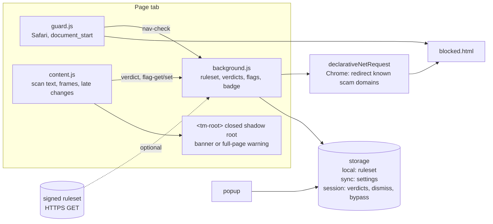

# ScamShield

ScamShield is a browser extension for Chrome and Safari (macOS and iOS) that
warns people, especially older adults, before they lose money or data to a
scam page.

- **Known scam websites** are stopped before the page loads, and the user sees a plain explanation instead.
- **Scam wording** on a page (fake virus alerts, parcel fees, gift-card payments, "safe account" transfers and more) raises a banner. Two strong signs raise a full-page warning that the user can still choose to pass.
- **News source notes** say who runs some news and satire websites.
- **Social media checks** mark risky posts and links in the Facebook feed.
- The toolbar popup lists what was found on the current page and why, and has a switch for each feature.

Everything is checked on the device. Nothing about the user's browsing leaves
it; see [PRIVACY.md](PRIVACY.md).

## Install for development

Requirements: Node.js 22 or newer. For Safari: macOS with Xcode 16 or newer.

```bash
npm ci
npm run build          # dist/chrome and dist/safari
```

### Chrome

1. Open `chrome://extensions` and turn on **Developer mode**.
2. Click **Load unpacked** and choose `dist/chrome`.

### Safari on macOS

```bash
npm run safari:build   # builds dist/safari, then both container apps
npm run safari:open    # launches the macOS app, which registers the extension
```

A locally built extension is not signed for distribution, so Safari needs two
settings first:

1. Safari → Settings → Advanced → turn on **Show features for web developers**.
2. Develop → **Allow Unsigned Extensions** (asks for your password; resets when Safari quits). In Safari 27 this switch is in Settings → Developer.
3. Safari → Settings → Extensions → turn on **ScamShield** → **Always Allow on Every Website…**.

### Safari on iOS (Simulator)

```bash
npm run safari:build -- --ios-only
npm run safari:sim     # installs and launches the app on the booted Simulator
```

Then in the Simulator: Settings → Apps → Safari → Extensions → ScamShield →
on, and Permissions → All Websites → **Allow**. Safari on iOS shows no prompt
while this is set to Ask, and the extension cannot check pages until it is
allowed.

## Test

```bash
npm test               # unit tests (node:test)
npm run test:e2e       # Chromium with the built extension (Playwright)
npm run test:safari    # macOS Safari via safaridriver; see test/safari/checklist.md
```

`test:e2e` needs `npm run build -- --target chrome` first and a Playwright
Chromium (`npx playwright install chromium`). `test:safari` needs
`safaridriver --enable`, Develop → **Allow Remote Automation** and **Allow
Unsigned Extensions** (Safari 27: Settings → Developer), and a build that
bundles the test ruleset:

```bash
npm run safari:build -- --mac-only --test-ruleset && npm run safari:open
```

When Safari runs the installed app in automation windows, the test uses it;
otherwise it loads `dist/safari` into its session itself. If creating the
session times out, quit Safari and run the test again.

Never ship a `--test-ruleset` build. What automation cannot see (the warning
contents, the popup, the badge, iOS) is in
[test/safari/checklist.md](test/safari/checklist.md).

## Release

The version in `package.json` is the only version number. The build writes it
into both manifests, and the Safari scripts pass it to Xcode as
`MARKETING_VERSION`.

```bash
npm run pack                # scamshield-<version>-chrome.zip for the Chrome Web Store
npm run safari:archive      # safari/build/ScamShield-<version>-{macOS,iOS}.xcarchive
```

`safari:archive` builds Release archives signed automatically with the
project's Apple team. The build number is the date and time (`YYYYMMDD.HHMM`);
`-- --build-number N` overrides it. Upload from Xcode → Window → Organizer →
Distribute App, which needs an active Apple Developer Program membership.

Store texts: [STORE_LISTING.md](STORE_LISTING.md) (Chrome Web Store) and
[APP_STORE.md](APP_STORE.md) (App Store).

## The ruleset

Everything ScamShield looks for is data, not code: scam domains, scam phrases
with a short explanation each, brand names that scams pretend to be, news
source notes and the page layouts for social sites. The source is
`data/ruleset.src.json`.

```bash
npm run lint:rules          # checks every pattern: safe regex, examples match as declared
npm run feeds               # downloads public phishing feeds into data/feeds/
npm run ruleset -- --key ~/.scamshield/ruleset-signing.key
```

`npm run ruleset` merges the feed domains, removes allowlisted ones, bumps the
version and signs the result with Ed25519. The extension ships with a bundled
copy (`src/data/default-ruleset.json`). It replaces that copy only with a
downloaded ruleset whose signature checks out against the public key in
`src/config.js` and whose version is higher. A ruleset that fails any check is
ignored and the last good copy stays in use.

### Keys

- `npm run keygen` writes the private key to `~/.scamshield/ruleset-signing.key` (mode 0600) and prints the public key for `src/config.js`.
- The private key never goes into the repository. Keep a copy in a password manager.
- To publish automatically, store the key as the repository secret `RULESET_SIGNING_KEY`. Set the repository variable `RULESET_URL` and the same address in `src/config.js`. Then turn on the schedule in `.github/workflows/ruleset.yml`, which publishes to GitHub Pages.

While `RULESET_URL` is empty, the extension makes no network requests at all
and uses the bundled ruleset.

## How it works



- `src/engine/` — pure logic shared by every part: URL and domain handling, ruleset checks, text signals, the warning level.
- `src/bg/` — the background worker: keeps the ruleset fresh, blocks known scam domains, stores each tab's verdict, holds dismiss and bypass choices, sets the badge.
- `src/content/` — scans the page (including frames and text that arrives later) and shows the warning. Safari adds `guard.js`, which leaves a known scam domain before the page shows.
- `src/ui/` — the banner, the full-page warning and the social labels, all built from text nodes inside a closed shadow root that page scripts cannot reach or restyle.
- `src/popup/`, `src/blocked/` — the toolbar popup and the explanation page for blocked websites.
- `safari/ScamShield/` — the Xcode project for the macOS and iOS container apps. Its extension resources point at `dist/safari`.

Safari differences and the reasons for them are in
[docs/SAFARI_COMPAT.md](docs/SAFARI_COMPAT.md).

## What it cannot do yet

`test/unit/edge-cases.test.js` runs legit pages, scam pages and the cases
below through the scanner. Pages that only ask for an email address, phone
number, tracking number or one-time code stay clean.

Missed today:

- Scam text in languages other than English (the phrases are English only).
- Digits or symbols in place of letters ("c0mputer").
- Scam text drawn in an image.
- A fake sign-in page with no scam wording, for a brand that is not in
  `impersonated_brands`.

False alarms today:

- Advice pages and news stories that quote a scam line word for word, unless
  the site is in `phrase_allowlist`.
- Shops that invite you to "buy a gift card".

## Reporting a mistake

The blocked page and the full-page warning have a **Report a mistake** link.
It opens a new issue in this repository. Change `REPORT_URL` in
`src/config.js` to use another address.
